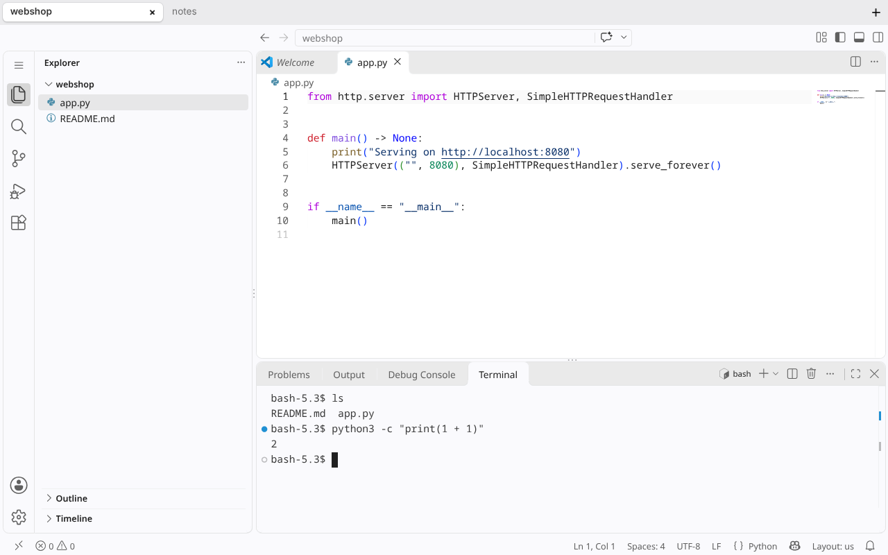

# vscode-tabs

Real tabs for VS Code on Linux. One window, a tab bar, and a full VS Code per
tab, each tab with its own folder.



## Why

VS Code has `window.nativeTabs`, which groups windows into tabs, but it only
works on macOS. On Linux every folder is a separate window. Window-manager tab
groups and "reparent the window into a tab bar" tricks don't help on Wayland,
where an app can't embed another app's window.

vscode-tabs takes a different route: VS Code ships an official browser version,
and `code serve-web` serves it from your machine. vscode-tabs starts one local
`code serve-web` and loads one VS Code web workbench per tab inside a small
Electron shell with a tab bar. Each tab is a complete VS Code with its own
explorer, editors, terminals and extension host.

## Run it

With Nix (x86_64-linux):

```sh
nix run github:yourpersonalhelperfriend/vscode-tabs             # uses `code` from your PATH
nix run github:yourpersonalhelperfriend/vscode-tabs -- ~/src/a ~/src/b   # open folders as tabs
nix run github:yourpersonalhelperfriend/vscode-tabs#with-vscode # falls back to nixpkgs' VS Code (unfree) if no `code` on PATH
```

Or install `packages.x86_64-linux.default` from the flake; it adds a
`vscode-tabs` command and a desktop entry.

You need VS Code installed: vscode-tabs runs its `code` CLI (`code serve-web`).
Set `VSCODE_TABS_CODE=/path/to/code` to pick a specific one, for example the
standalone VS Code CLI.

**First start downloads the VS Code server.** `code serve-web` fetches the
server build that matches your VS Code version from Microsoft (a few hundred MB
unpacked) into `~/.vscode/cli/serve-web/` and reuses it after that. The tab bar shows
"Downloading VS Code server…" meanwhile. Running it means you accept the
[VS Code Server license](https://aka.ms/vscode-server-license);
vscode-tabs passes `--accept-server-license-terms`.

### Development

```sh
nix develop          # Node, and npm's electron pointed at nixpkgs' Electron
npm install
npm start            # builds and runs; pass folders with: npm start -- ~/src/a
```

Outside NixOS, plain `npm install && npm start` works with npm's own Electron.

## Keys

| Key | Action |
| --- | --- |
| Ctrl+T | Open a folder in a new tab (native folder picker) |
| Ctrl+Tab / Ctrl+Shift+Tab | Next / previous tab |
| Ctrl+1 … Ctrl+8 | Go to tab 1 … 8 |
| Ctrl+9 | Go to the last tab |
| Ctrl+Shift+W | Close the tab |
| Ctrl+Alt+Shift+I | Developer tools for the current tab |

Every other key goes to VS Code, including Ctrl+W, Ctrl+N, Ctrl+P and the
F-keys. The app has no menu bar, so no menu accelerators steal keys. VS
Code's web build normally leaves Ctrl+W, Ctrl+N and Ctrl+T to the browser; here
it is told it runs as an installed app, so it uses its desktop keybindings.

The keys above take precedence over VS Code's own bindings for the same keys:
Ctrl+T (VS Code: go to symbol in workspace), Ctrl+Tab (switch editors) and
Ctrl+1…9 (focus editor group). Rebind those commands in VS Code if you use them.

Mouse: click a tab to switch, middle-click or × to close, drag to reorder,
`+` or double-click the empty bar to open a folder. A dot on a tab means the
active editor in that tab has unsaved changes (read from VS Code's window
title, so it follows the `window.title` setting; the default shows it).

Running `vscode-tabs ~/src/other` while it is already open adds a tab to the
open window.

## How it works

- One `code serve-web --host 127.0.0.1` per app run. Its port is picked at
  random on first start and then kept (saved in `tabs.json`), because VS Code
  web keeps its settings, keybindings, UI state and unsaved-file backups in
  browser storage, which is tied to the address including the port. If that
  port is busy at start, the run uses another one and VS Code looks fresh
  until the usual port is free again.
- The connection token is 32 random bytes per launch. It goes to the CLI
  through a 0600 file in `$XDG_RUNTIME_DIR` (not on the command line, so it is
  not visible in `ps`), into each tab once via `?tkn=` (serve-web swaps it for
  a cookie), and never into logs: the CLI prints it, and vscode-tabs scrubs it
  from the server log at `~/.local/state/vscode-tabs/server.log`.
- The server runs in its own process group under a small shell watchdog, so
  it stops with the app, even if the app crashes.
- Each tab loads `http://127.0.0.1:<port>/?folder=<path>`. If you open another
  folder from inside VS Code, the tab follows it; "New Window" inside VS Code
  opens a new tab.
- Open tabs (folders, order, active tab) and the window size are saved to
  `~/.local/state/vscode-tabs/tabs.json` (`$XDG_STATE_HOME` respected) and
  restored on start. Background tabs load when you first switch to them.
- Links to other sites open in your default browser. Clipboard access is
  granted to the local server only. Downloads use Electron's save dialog and
  uploads the native file chooser (both untested so far).
- The tab bar follows the system light/dark setting.

### NixOS

The server `code serve-web` downloads is a generic Linux build whose bundled
`node` can't run on NixOS out of the box. VS Code supports running it against
another glibc: the Nix package sets `VSCODE_SERVER_CUSTOM_GLIBC_LINKER`,
`VSCODE_SERVER_CUSTOM_GLIBC_PATH` and `VSCODE_SERVER_PATCHELF_PATH` to glibc,
libstdc++ and patchelf from nixpkgs (unless you already set them), and the
server patches its `node` on start. Because of this, VS Code shows a one-time
notice that you are connected to an unsupported OS; tick "Do not show again".
`nix develop` sets the same variables for `npm start`.

## Limits and caveats

- **Extensions run on the server side**, as in Remote-SSH or Codespaces. Most
  work; extensions that only support the desktop UI side, or that need
  Electron APIs, may not.
- **Settings and extensions are separate from desktop VS Code.** Extensions
  install into `~/.vscode-server/extensions`; settings and keybindings live in
  the app's browser storage under `~/.config/vscode-tabs` (that is how VS Code
  web works), not in `~/.config/Code`. Copy your settings once, or use
  Settings Sync.
- **The VS Code version follows your installed `code` CLI.** Updating VS Code
  makes serve-web download the matching server on next start.
- **Memory is about the same as separate windows**: every tab is a full
  workbench with its own extension host. Tabs you never open after a restart
  are not loaded.
- Webviews (Markdown preview, extension pages, release notes) are served by VS
  Code from `*.vscode-cdn.net`, so they need internet access. That is how VS
  Code web works.
- Signing in (GitHub, Settings Sync, Copilot) goes through the browser and may
  not complete back into the app. Untested.
- Dirty dot shows the active editor's state only, not every unsaved file.
- Tested on Linux under Xvfb (X11) only. Not yet tried in a real GNOME
  Wayland session. nixpkgs' Electron runs natively on Wayland when
  `NIXOS_OZONE_WL=1` is set, otherwise it may use XWayland.

## License

MIT
